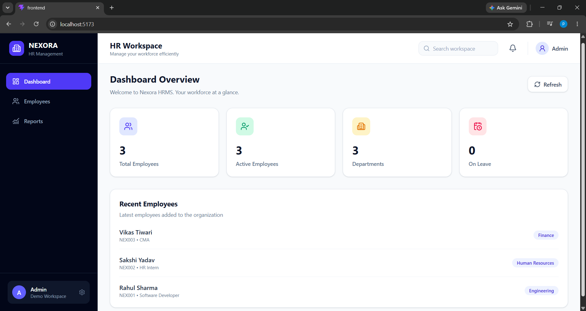
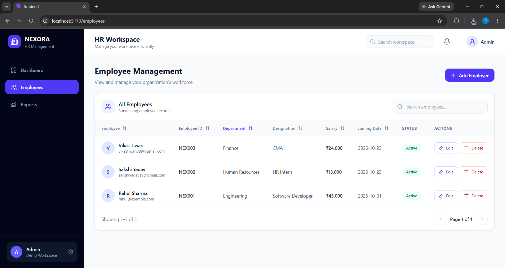
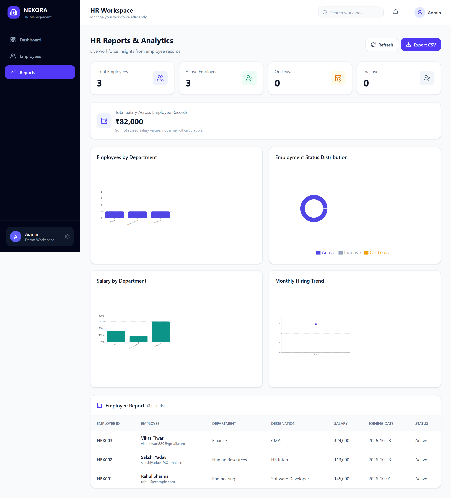
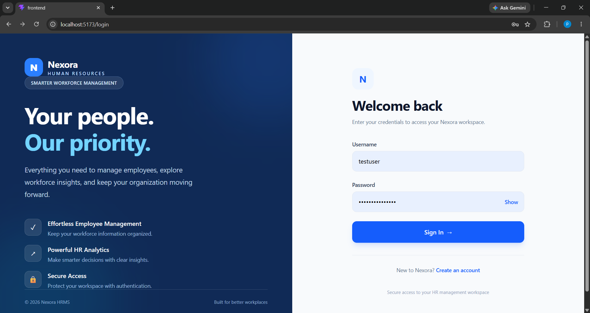
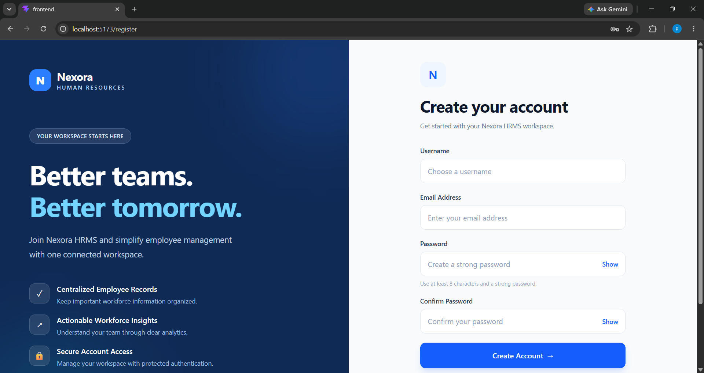
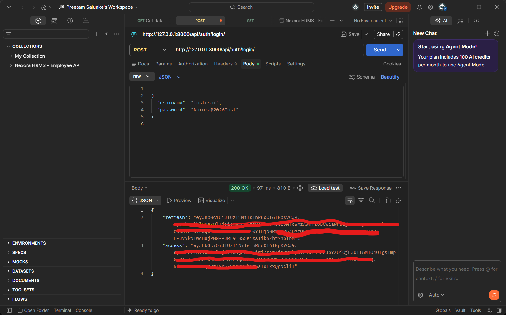
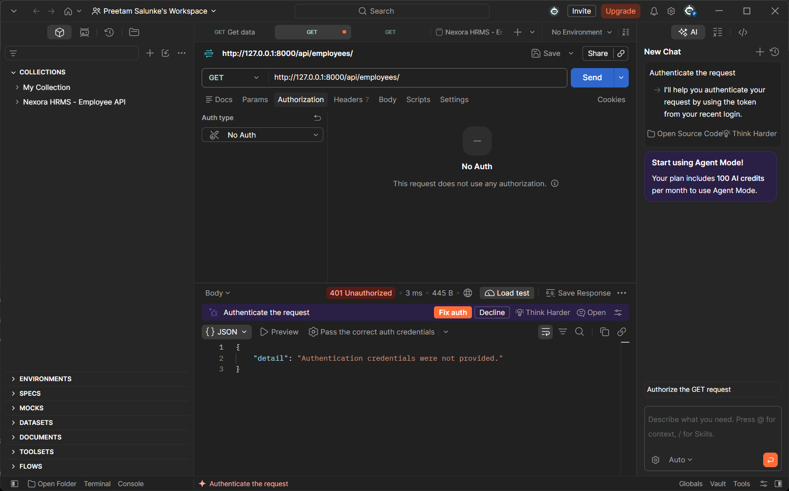
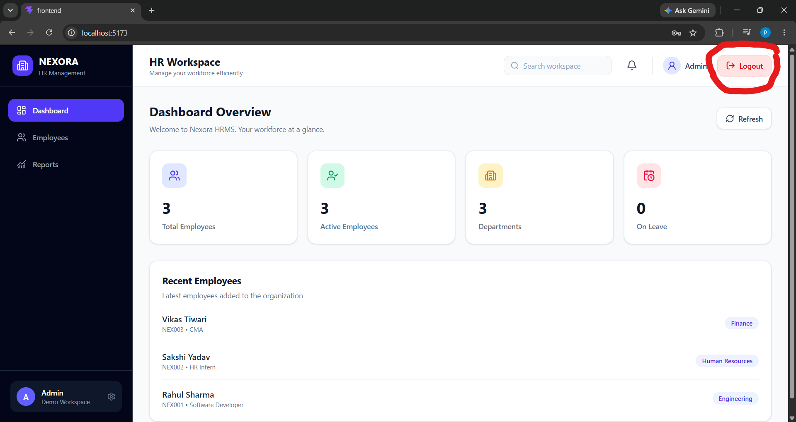

# Nexora HRMS — Employee Management System

A modern, responsive ****Full Stack Human Resource Management System**** built using React, Django REST Framework, and MySQL.

Developed as part of the ****WeIntern Full Stack Development Internship — Week 2, Tasks 2 & 3****.

## Project Overview

Nexora HRMS helps organizations manage employee information through a centralized and authenticated workspace.

The application supports employee CRUD operations, workforce analytics, department-wise reports, CSV exports, user registration, JWT-based login, protected routes, and secure logout.

## Features

### Employee Management — Task 2

- Add new employees

- View employee records

- Edit employee information

- Delete employees with confirmation

- Search, sort, and paginate employee records

- Validate employee information

- Restrict employee API access to authenticated users

### Dashboard

- Total employee count

- Active employees

- Department statistics

- Employees on leave

- Recent employee records

### Reports & Analytics

- Department-wise employee distribution

- Employment status donut chart

- Department-wise salary analysis

- Monthly hiring trend

- Scroll-triggered chart animations

- Employee reports table

- CSV export

### Authentication & Authorization — Task 3

- User registration with username, email, and password

- Password confirmation and validation

- Secure password hashing using Argon2

- User login with JWT authentication

- JWT access and refresh tokens

- Automatic access token attachment to API requests

- Automatic access token refresh

- Protected frontend routes

- Protected employee management APIs

- User profile endpoint

- Logout with refresh token blacklisting

- Automatic login redirection after session expiry

- Error handling for invalid credentials and registration failures

### User Interface

- Responsive layouts

- Modern sidebar navigation

- Dashboard summary cards

- Interactive charts

- Loading and error states

- Premium split-screen Login and Registration pages

- Password show/hide controls

- Registration success notifications

- Logout button with loading state

## Tech Stack

\| Layer | Technologies |

\|---|---|

\| Frontend | React, Vite, Tailwind CSS |

\| Routing | React Router |

\| Charts | Recharts |

\| HTTP Client | Axios |

\| Icons | Lucide React |

\| Backend | Python, Django, Django REST Framework |

\| Authentication | Simple JWT, Argon2 |

\| Database | MySQL |

\| Version Control | Git, GitHub |

\| API Testing | Postman |

## Project Structure

\`\`\`text

nexora-hrms/

├── backend/

│   ├── config/

│   ├── accounts/

│   ├── employees/

│   ├── manage.py

│   └── requirements.txt

├── frontend/

│   ├── public/

│   ├── src/

│   │   ├── components/

│   │   │   ├── auth/

│   │   │   └── layout/

│   │   ├── pages/

│   │   ├── services/

│   │   │   └── api.js

│   │   └── App.jsx

│   └── package.json

├── demo/
│   └── CRUD_Demo.mp4
├── screenshots/

├── .gitignore

└── README.md

\`\`\`

## Installation & Setup

### Prerequisites

- Python

- Node.js and npm

- MySQL Server

- Git

### 1. Clone Repository

\`\`\`bash

git clone https\://github.com/PreetamSalunke/nexora-hrms.git

cd nexora-hrms

\`\`\`

### 2. Backend Setup

\`\`\`bash

cd backend

python -m venv venv

\`\`\`

Activate the virtual environment on Windows:

\`\`\`powershell

.\venv\Scripts\Activate.ps1

\`\`\`

Install dependencies:

\`\`\`bash

pip install -r requirements.txt

\`\`\`

Create a MySQL database named \`nexora_hrms\`.

Create a \`backend/.env\` file with the environment variables required by \`config/settings.py\`, including the Django secret key and database credentials.

Example:

\`\`\`env

DJANGO_SECRET_KEY=replace_with_your_own_secure_key

\`\`\`

Never commit real credentials or secret keys.

Run migrations:

\`\`\`bash

python manage.py migrate

\`\`\`

Start Django:

\`\`\`bash

python manage.py runserver

\`\`\`

Backend runs at http\://127.0.0.1:8000/

### 3. Frontend Setup

Open another terminal from the project root:

\`\`\`bash

cd frontend

npm install

\`\`\`

Create \`frontend/.env\`:

\`\`\`env

VITE_API_BASE_URL=http\://127.0.0.1:8000/api/

\`\`\`

Start React:

\`\`\`bash

npm run dev

\`\`\`

Frontend runs at http\://localhost:5173/

## Authentication Workflow

### 1. Registration

Users create an account using:

- Username

- Email address

- Password

- Confirm password

The backend validates the submitted information and securely hashes passwords before storing them in the database.

Successful registration redirects users to the Login page with a success notification.

### 2. Login

Users log in using their username and password.

The backend validates credentials and returns:

- JWT access token

- JWT refresh token

The frontend temporarily stores these tokens in browser \`sessionStorage\` for the internship demo.

### 3. Protected Routes

The following frontend routes require an access token:

\| Route | Description |

\|---|---|

\| \`/\` | Dashboard |

\| \`/employees\` | Employee Management |

\| \`/reports\` | Reports & Analytics |

Unauthenticated visitors are redirected to \`/login\`.

Backend employee endpoints also require authentication.

### 4. Automatic Token Refresh

Axios attaches the access token to authenticated API requests.

When an access token expires:

1. The API returns HTTP 401.

2. The frontend attempts to refresh the access token.

3. If successful, the original request is retried.

4. If refresh fails, local tokens are cleared and the user is redirected to Login.

### 5. Logout

When users click Logout:

1. The frontend sends the refresh token to the logout endpoint.

2. The backend attempts to blacklist the refresh token.

3. The frontend clears stored access and refresh tokens.

4. The user is redirected to the Login page.

Note: Refresh token blacklisting does not immediately revoke an already issued access token. That token remains valid until expiration.

## API Endpoints

### Authentication APIs

\| Method | Endpoint | Description | Authentication |

\|---|---|---|---|

\| POST | \`/api/auth/register/\` | Register user | Public |

\| POST | \`/api/auth/login/\` | Obtain JWT tokens | Public |

\| POST | \`/api/auth/token/refresh/\` | Refresh access token | Refresh token |

\| GET | \`/api/auth/profile/\` | View user profile | Required |

\| POST | \`/api/auth/logout/\` | Blacklist refresh token | Required |

### Employee APIs

\| Method | Endpoint | Description | Authentication |

\|---|---|---|---|

\| GET | \`/api/employees/\` | List employees | Required |

\| POST | \`/api/employees/\` | Create employee | Required |

\| GET | \`/api/employees/{id}/\` | Retrieve employee | Required |

\| PATCH | \`/api/employees/{id}/\` | Update employee | Required |

\| DELETE | \`/api/employees/{id}/\` | Delete employee | Required |

### JWT Authorization Header

Authenticated API requests use:

\`\`\`http

Authorization: Bearer YOUR_ACCESS_TOKEN

\`\`\`

### Example Login Request

****POST**** \`/api/auth/login/\`

\`\`\`json

{

  "username": "your_username",

  "password": "your_password"

}

\`\`\`

A successful response contains access and refresh tokens.

### Example Logout Request

****POST**** \`/api/auth/logout/\`

Authorization header:

\`\`\`http

Authorization: Bearer YOUR_ACCESS_TOKEN

\`\`\`

Request body:

\`\`\`json

{

  "refresh": "YOUR_REFRESH_TOKEN"

}

\`\`\`

## Authentication Testing

Authentication functionality can be tested using the React application and Postman.

\| Test | Expected Result |

\|---|---|

\| Register valid user | HTTP 201 |

\| Login with valid credentials | HTTP 200 |

\| Login with incorrect password | HTTP 401 |

\| Access protected API without authentication | HTTP 401 |

\| Access protected API with valid JWT | HTTP 200 |

\| Refresh valid token | HTTP 200 |

\| Refresh blacklisted token | HTTP 401 |

\| Open protected frontend route without token | Redirect to Login |

\| Logout | Clear local session and redirect to Login |

## 🎬 Project Demo Videos

### Task 2 — Employee CRUD Demonstration
[▶️ Watch CRUD Demo](demo/CRUD_Demo.mp4)

### Task 3 — JWT Authentication Demonstration
[▶️ Watch Authentication Demo](demo/Authentication_Demo.mp4)

## Screenshots

### Dashboard

### Employee Management

### Reports & Analytics

### Login Page

### Registration Page

### JWT Authentication Testing

### Protected API Testing

### Logout

\> Screenshots must be added to the \`screenshots/\` directory using the filenames above.

## Security Notes

- Passwords are hashed using Django's password hashing system, with Argon2 configured as the preferred hasher.

- Employee APIs require authenticated access.

- JWT refresh tokens can be blacklisted during logout.

- Access tokens expire according to backend JWT configuration.

- Sensitive credentials are stored in environment variables.

- Environment files should not be committed to GitHub.

- Browser \`sessionStorage\` is used temporarily for this internship project. A production deployment should use a more robust token/session strategy, such as secure HttpOnly cookies with appropriate CSRF protection.

- Role-based access control is not yet implemented. Authenticated users currently share the same employee API permissions.

## Future Enhancements

- Role-based access control

- Admin, HR, and Employee roles

- Password reset functionality

- Secure production authentication deployment

- Additional HR management modules

- Attendance and leave management

## Developer

****Preetam Gorakhnath Salunke****

GitHub: [PreetamSalunke](https\://github.com/PreetamSalunke)

Project Repository: [Nexora HRMS](https\://github.com/PreetamSalunke/nexora-hrms)

## Project Status

****Week 2 — Task 2:**** Employee Management CRUD, Dashboard, and Reports implemented.

****Week 2 — Task 3:**** User Registration, Login, JWT Authentication, Protected Routes, Protected Employee APIs, Token Refresh, and Logout implemented.

****Current Status:**** Authentication implementation completed; final documentation, screenshots, and submission preparation in progress.
